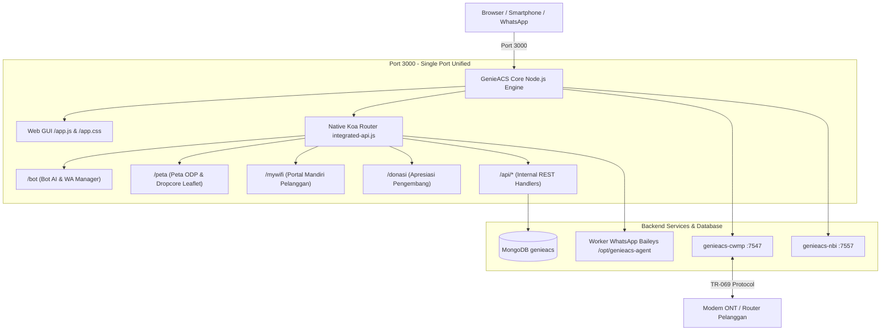

<div align="center">

# 🚀 GenieACS All-in-One MultiTab Edition
### Platform Manajemen TR-069 ACS Terintegrasi Port Tunggal (Port 3000)
**Dilengkapi Bot AI, WhatsApp Gateway, Peta Geospasial ODP, & Portal Mandiri Pelanggan (MyWiFi)**

[](https://genieacs.com)
[](https://nodejs.org)
[](https://www.mongodb.com)
[](https://armbian.com)
[](LICENSE)

---

### 🌟 Showcase Tampilan UI

<p align="center">
  
  
</p>
<p align="center">
  
  
</p>

</div>

---

## 📖 Ringkasan Proyek

**GenieACS All-in-One MultiTab Edition** adalah distribusi mutakhir dari GenieACS yang dirancang khusus untuk ISP, RT/RW Net, dan teknisi jaringan FTTH. Proyek ini menggabungkan seluruh ekosistem monitoring dan automasi pelanggan ke dalam **satu port tunggal (Port 3000)** tanpa membutuhkan dependensi service Python terpisah maupun port proxy (Port 7558 dinonaktifkan).

Sangat hemat memori (RAM), stabil, dan kompatibel dengan STB Android (B860H, HG680P ber-OS Armbian), VPS Cloud (Ubuntu 20.04/22.04/24.04), serta Debian 10/11/12.

---

## ✨ Fitur Unggulan

| Modul | Rute URL | Deskripsi Fitur |
| :--- | :--- | :--- |
| **🌓 Dashboard UI & Dark Mode** | `http://<IP>:3000/` | Antarmuka resmi GenieACS dengan tombol pengalih **Dark/Light Theme** instan (tersimpan otomatis di browser) serta shortcut navigasi cepat di bar atas dan sidebar admin. |
| **📑 MultiTab & Tab INFO Rapi** | `http://<IP>:3000/#!/devices/:id/info` | 7 Kategori MultiTabs (`Summary`, `WAN`, `LAN`, `WLAN`, `USER`, `TR069`, `INFO`). Tab INFO kini tampil elegan dengan tabel resmi parameter live (Last inform, online dot, Serial number, PPPoE username, IP WAN, Redaman RX Power, Uptime) dan form terintegrasi pendataan pelanggan & ODP. |
| **🤖 Panel Bot AI & WhatsApp** | `http://<IP>:3000/bot` | Panel manajemen bot WhatsApp berbasis Baileys dan Bot Telegram bertenaga Google Gemini AI. Pengaturan API Key, brand, dan template respon dalam satu halaman. |
| **🗺️ Peta Geospasial ODP & Klien** | `http://<IP>:3000/peta` | Peta interaktif Leaflet untuk monitoring sebaran ODP, penarikan jalur kabel dropcore otomatis ke rumah pelanggan, penghitungan port ODP terpakai, dan audit redaman optik dBm. |
| **📱 Portal Mandiri MyWiFi** | `http://<IP>:3000/mywifi` | Portal self-service bagi pelanggan untuk cek status koneksi, ganti nama WiFi (SSID) & password secara mandiri, serta restart modem langsung dari smartphone tanpa merepotkan admin. |
| **☕ Halaman Donasi** | `http://<IP>:3000/donasi` | Halaman apresiasi dan dukungan pengembangan untuk komunitas. |
| **⚡ Native Single-Port Engine** | `http://<IP>:3000/api/*` | Seluruh REST API diinjeksi secara native ke Koa Router GenieACS. Service Python legacy dinonaktifkan, sehingga bebas bentrok port dan sangat hemat resource CPU/RAM. |

---

## 🏗️ Diagram Arsitektur Sistem



---

## ⚡ Instalasi Cepat (Quick Start)

Pilih salah satu metode instalasi di bawah ini pada server Anda (login sebagai `root` atau gunakan `sudo`):

### 1. Download & Masuk ke Direktori
```bash
git clone https://github.com/alijayanet/genieacs-multitab.git
cd genieacs-multitab
chmod +x install.sh
```

---

### 2. Jalankan Installer Interaktif
```bash
sudo ./install.sh
```
Pilih opsi yang sesuai dengan kondisi server Anda:
- **Pilihan 1 (`Fresh Server`)**: Untuk server baru/kosong yang baru diinstall OS Linux.
- **Pilihan 2 (`Upgrade Server`)**: Untuk server yang **sudah memiliki GenieACS standard** dan ingin langsung ditingkatkan ke versi All-in-One MultiTab tanpa kehilangan data perangkat.

---

### 3. Instalasi Otomatis (Non-Interaktif)

#### A. Fresh Server (Server Kosong dari Awal)
Gunakan perintah ini untuk VPS / STB baru:
```bash
sudo ./install.sh --fresh
```
*Apa yang dilakukan skrip:*
1. Memperbarui paket sistem (`apt update & upgrade`).
2. Memasang **Node.js 20 LTS** & npm via Nodesource.
3. Memasang & mengaktifkan **MongoDB Server**.
4. Memasang **GenieACS v1.2.13** core.
5. Menyiapkan konfigurasi environment `/opt/genieacs/genieacs.env` dengan JWT Secret acak yang aman.
6. Memasang 4 systemd service standar GenieACS (`cwmp`, `nbi`, `fs`, `ui`).
7. Menginjeksi All-in-One router, menyalin frontend lengkap (Dark mode, Tab INFO, Bot, Peta, MyWiFi).
8. Mengimpor seed 39 VirtualParameters, Presets, dan Provisions ke MongoDB.
9. Memasang worker WhatsApp Bot Baileys di `/opt/genieacs-agent`.

---

#### B. Upgrade Server (Sudah Ada GenieACS Standard)
Gunakan perintah ini jika server Anda sudah berjalan GenieACS sebelumnya:
```bash
sudo ./install.sh --upgrade
```
*Apa yang dilakukan skrip:*
1. Mendeteksi direktori instalasi GenieACS Anda secara otomatis.
2. Membuat backup aman file asli (`bin/genieacs-ui.orig.bak`).
3. Menginjeksi router native `integrated-api.js` dan menyalin seluruh file antarmuka ke folder `public/`.
4. Memasang modul WhatsApp Baileys di `/opt/genieacs-agent` dan mengaktifkan service-nya.
5. Menonaktifkan service Python lama (`genieacs-agent.service` pada port 7558) agar tidak boros RAM dan tidak bentrok.
6. Mengimpor 39 VirtualParameters dan template MultiTabs secara aman menggunakan metode *upsert* (**data perangkat dan konfigurasi yang sudah ada tetap aman 100%**).
7. Merestart service `genieacs-ui` dan memverifikasi kesehatan sistem.

---

## 🌐 Daftar URL Akses Layanan

Setelah instalasi selesai, seluruh layanan langsung dapat diakses melalui browser pada **Port 3000**:

- **GenieACS Web UI** : `http://<IP_SERVER>:3000/`
- **Tab INFO Detail Perangkat** : `http://<IP_SERVER>:3000/#!/devices/<DEVICE_ID>/info`
- **Panel Bot AI & WhatsApp** : `http://<IP_SERVER>:3000/bot`
- **Peta Geospasial ODP** : `http://<IP_SERVER>:3000/peta`
- **Portal Mandiri Pelanggan** : `http://<IP_SERVER>:3000/mywifi`
- **Halaman Donasi** : `http://<IP_SERVER>:3000/donasi`
- **Status Koneksi WhatsApp** : `http://<IP_SERVER>:3000/api/whatsapp/status`

---

## 📊 Daftar 39 Virtual Parameters Bawaan

Paket ini sudah dilengkapi template VirtualParameters otomatis untuk memudahkan pembacaan status modem populer (ZTE, Huawei, Fiberhome, VSOL, GM220, dll.):

| Parameter | Keterangan |
| :--- | :--- |
| `VirtualParameters.pppoeUsername` | Username akun PPPoE yang aktif pada modem |
| `VirtualParameters.pppoePassword` | Password PPPoE modem |
| `VirtualParameters.pppoeIP` | Alamat IP Publik / WAN yang didapatkan modem |
| `VirtualParameters.RXPower` | Nilai redaman optik (dBm) diterima dari OLT |
| `VirtualParameters.TXPower` | Nilai daya pancar optik (dBm) modem |
| `VirtualParameters.getpppuptime` | Durasi koneksi PPPoE berlangsung (Uptime) |
| `VirtualParameters.PonUptime` | Durasi koneksi optik PON aktif |
| `VirtualParameters.Suhu` | Suhu temperatur hardware ONT (°C) |
| `VirtualParameters.Voltase` | Tegangan supply internal ONT (Volt) |
| `VirtualParameters.WlanSSID1` | Nama SSID WiFi 2.4 GHz |
| `VirtualParameters.WlanKey1` | Password sandi WiFi 2.4 GHz |
| `VirtualParameters.WlanSSID2` | Nama SSID WiFi 5 GHz (untuk dual-band) |
| `VirtualParameters.TotalAssociatedDevices` | Jumlah smartphone/laptop yang sedang terhubung ke WiFi |
| `VirtualParameters.DeviceModel` | Deteksi merk & tipe perangkat secara akurat |

---

## 🔧 Manajemen Layanan (Systemd)

Untuk memeriksa atau merestart layanan:

```bash
# Cek status UI All-in-One (Port 3000)
systemctl status genieacs-ui

# Cek status Bot WhatsApp
systemctl status genieacs-whatsapp

# Cek status CWMP & NBI
systemctl status genieacs-cwmp
systemctl status genieacs-nbi

# Restart UI
systemctl restart genieacs-ui
```

---

## ❓ Tanya Jawab (FAQ)

<details>
<summary><b>1. Apakah data perangkat dan pelanggan saya hilang saat melakukan Upgrade?</b></summary>
<b>Tidak!</b> Script upgrade menggunakan metode <i>upsert</i> ke database MongoDB. Data perangkat yang tersimpan di koleksi <code>devices</code> tidak disentuh sama sekali. Template MultiTabs dan VirtualParameters hanya ditambahkan atau diperbarui tanpa menghapus data yang sudah ada.
</details>

<details>
<summary><b>2. Mengapa port 7558 tidak lagi digunakan?</b></summary>
Sebelumnya fitur bot dan portal menggunakan service Python terpisah yang membuka port 7558. Pada arsitektur All-in-One ini, seluruh endpoint dipindahkan ke router native Node.js di dalam service <code>genieacs-ui</code> (Port 3000). Hal ini membuat pemakaian RAM turun hingga 40% dan menghilangkan masalah firewall atau port tertutup.
</details>

<details>
<summary><b>3. Mengapa tampilan Dark Theme tidak berubah saat pertama kali dibuka?</b></summary>
Buka browser dan lakukan hard refresh (tekan <code>Ctrl + F5</code>) untuk membersihkan cache file JavaScript lama di browser Anda. Klik tombol ikon bulan/matahari di bar atas untuk mengganti tema sesuai keinginan.
</details>

---

## 🤝 Dukungan & Kontribusi

Proyek ini dikelola dan dikembangkan untuk kemajuan ekosistem RT/RW Net di Indonesia oleh **ALIJAYA NET**.

- **GitHub Repository**: [alijayanet/genieacs-multitab](https://github.com/alijayanet/genieacs-multitab)
- **Halaman Donasi & Dukungan**: Kunjungi menu `/donasi` pada server Anda.

---
<div align="center">
  <b>ALIJAYA NET Enterprise</b> • Dibuat dengan ❤️ untuk Komunitas Pegiat Jaringan Indonesia
</div>
